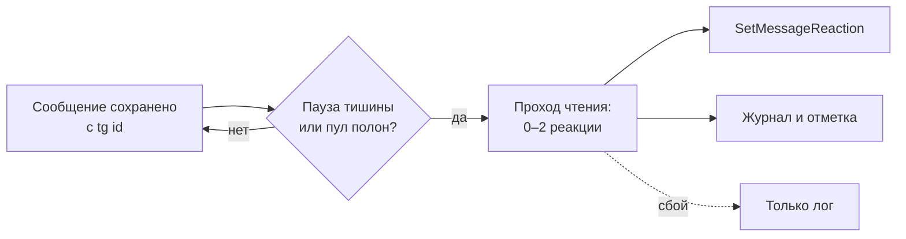

# Design

## Context

Сейчас бот сохраняет каждое некомандное текстовое сообщение чата, но реагирует только на обращение по алиасу или реплай: остальные сообщения проходят мимо. Единственное место, где оценивается настроение персоны, — план ответа; фоновый анализ памяти раз в 50 сообщений занят фактами. В истории сообщений нет Telegram-идентификатора, поэтому поставить реакцию на сохранённое сообщение сейчас нечем.

Ограничения Telegram: бот держит не больше одной реакции на сообщение, ставить можно только эмодзи из разрешённого набора, реакция видна всем участникам. Библиотека 10.3.0 умеет ставить реакции (`SetMessageReaction`), это уже проверено при переезде (ADR-0001). Модульное разделение — ADR-0003.

## Goals / Non-Goals

**Goals:**

- Дать боту видимый молчаливый отклик на прочитанное, не превращая его в генератор гирлянды.
- Уложиться в один запрос к модели на пачку сообщений, а не на сообщение.
- Позволить держать реакции на дешёвой модели, не меняя модель ответов.
- Не создавать новых видимых сбоев: любая ошибка прохода — только лог.

**Non-Goals:**

- Менять эмоции, обиды и память от чтения.
- Ставить метку памяти ✍ (отдельный шаг позже).
- Реагировать на нетекст, на свои сообщения и на других ботов.
- Читать чужие реакции и показывать аналитику реакций в админке.
- Ручной запуск прохода из админки.

## Decisions

### 1. Отдельный проход чтения вместо вызова на сообщение

Проход накапливает новые сообщения чата и делает один запрос к модели на пачку.

| Вариант | Почему нет |
| --- | --- |
| Вызов на каждое сообщение | В каждом запросе едет неизменяемый префикс: характер, эмоции, люди, обиды — тысячи токенов. Платить его за каждое «ок» дорого, а при серии вызовов модель не видит контекст и ставит реакции независимо. |
| Расширить план ответа | План срабатывает только на обращение, то есть реакции были бы ровно там, где бот и так отвечает. Плюс каталог памяти в плане раздувает запрос. |
| Пачка с задержкой | Выбран: один вызов на серию, модель видит контекст и выбирает самое яркое. |

### 2. Проход ставит только реакции, настроение остаётся в плане

Альтернатива «чтение меняет настроение» отвергнута: настроение рулит ответами и оценивается сильной моделью с полным контекстом, а проход строится вокруг дешёвой модели и короткого контекста. Иначе либо проход дорожает в разы, либо персонаж становится эмоционально дёрганым. Плюс одно и то же сообщение считалось бы дважды — планом и проходом, — а разбор обид и извинений пришлось бы переносить.

### 3. Запуск: тишина или полный пул, счётчик на чат

Проход запускается, когда после последнего нового сообщения прошла пауза тишины ИЛИ накопилось `размер пула` сообщений. Размер пула одновременно ограничивает пачку сверху — отдельного порога «N сообщений» нет. Планировщик раз в 10 секунд смотрит чаты: так проход переживает перезапуск и не требует таймера на каждый чат. Часового потолка нет: шум ограничивают правило «не больше двух самых ярких» и выключатель функции.

### 4. Данные: идентификатор сообщения, журнал и отметка

- `ai.ai_messages.tg_message_id` + `UNIQUE (chat_id, tg_message_id)` — без него реакция не привяжется к сообщению, а повторное поступление апдейта не отличить от нового сообщения.
- `ai.message_reactions` — журнал: чат, сообщение, эмодзи, причина, время. Нужен для отладки и для проверки «уже отреагировали».
- `ai.read_state` — отметка, докуда чат прочитан; при первом включении ставится на последнее сообщение, чтобы история не получила реакции задним числом.
- `config.reaction_emojis` — каталог: эмодзи, текст, признак метки памяти, признак активности.

Альтернатива «держать пачку в памяти» отвергнута: после перезапуска теряется и пачка, и отметка, а сообщения уже удаляются окном истории. Отметку анализа памяти переиспользовать нельзя — это другой прогресс.

### 5. Каталог эмодзи: фиксированный набор строк, одна кнопка

Набор разрешённых Telegram эмодзи — константа в коде. Админка рисует все строки сразу, а в базе хранит только текст и два признака. Добавления и удаления строк нет: значит, нет дублей и нельзя сохранить эмодзи, который Telegram отклонит. Сохранение одно на весь список, включённая строка без текста отклоняет сохранение целиком и подсвечивается красным.

Альтернатива «пустой список с добавлением» отвергнута: понадобились бы отдельные формы добавления и удаления, проверка допустимости эмодзи и защита от дублей при том же результате.

### 6. Промпт прохода: короткий контекст, каталог дописывается кодом

В запрос идут: сжатый характер персоны, текущие эмоции, обиды на авторов, несколько фактов о каждом авторе и сообщения с идентификаторами. Включённые эмоциональные эмодзи с текстами дописываются из каталога — администратор не дублирует их в промпте. Неизменяемая часть (характер и правила) идёт первой, переменная (эмоции, люди, сообщения) — последней: так срабатывает кэш контекста у провайдера. Ответ — JSON-объект со списком реакций, температура низкая, потолок токенов маленький.

### 7. Своя модель для реакций

Отдельная пара настроек `aiReactionRoute` + `aiReactionModel`; при выключенном флажке используется основная пара. Клиент получает явную пару и разрешает провайдера по каталогу, а не по глобальной настройке. Выбор в админке повторяет основную модель: два режима и каскад; скрипт каскада обобщается на блок, а не копируется. Флажок выключен — поля выбора недоступны с подсказкой, что считает основная модель.

### 8. Отказ — тишина

Неудача модели, неразобранный ответ, эмодзи вне каталога и отказ Telegram обрабатываются одинаково: запись в лог и продолжение. В чат ничего не уходит — пропущенная реакция незаметна, сообщение об ошибке заметно и пугает.

## Risks / Trade-offs

- **Набор эмодзи разойдётся с документацией Telegram** → константу сверить с Bot API при реализации, локально проверять по каталогу, отказ `REACTION_INVALID` писать в лог; неверную строку админка включить не даст.
- **Гирлянда без часового потолка** → правило «0–2 и только яркие» в промпте, выключатель как аварийный тормоз, журнал для наблюдения. Потолок можно добавить позже, данные для него уже есть.
- **Дешёвая модель ошибается в отношении** → ставка низкая: реакцию видно и легко переиграть, настроение и память она не трогает. Лечится текстами каталога и промптом.
- **Ограничения провайдера по частоте** → один запрос на пачку, проходы по чату последовательные, без параллельных вызовов.
- **Сообщение удалено до реакции** → Telegram отказывает, проход пишет лог и продолжает с остальными.
- **Privacy mode у бота** → если бот не получает все сообщения группы, проход увидит только обращения. Проверить на сервере до выкатки; код на это не влияет.
- **Гранты базы** → новая таблица `config.reaction_emojis` создаётся под владельцем таблиц, а `ai_user` читает config по правам на схему; для новых объектов добавить явные гранты в файл ролей, иначе бот не прочитает каталог.

## Migration Plan

1. `migrations/ai/` — колонка `tg_message_id` и уникальный индекс, таблица журнала реакций, таблица отметки прочитанного.
2. `migrations/config/` — таблица каталога эмодзи и начальное заполнение: эмоциональные эмодзи выключены, кроме стартового набора; ✍ помечена как метка памяти.
3. `migrations/roles/` — гранты: чтение каталога боту, запись в новые таблицы `ai`, чтение новых таблиц админкой там, где понадобится.
4. Выкатка: сначала миграции, затем деплой бота и админки; функция по умолчанию выключена, включение — в админке.
5. Откат: снять выключатель и вернуть предыдущую сборку; таблицы и колонка остаются, они не мешают прежнему поведению.

## Open Questions

- Точный список разрешённых Telegram эмодзи — сверить с документацией Bot API при реализации; это константа в коде, спеки не меняет.
- Достаточно ли потолка токенов ответа прохода для JSON со списком реакций — подобрать константой по логам.
